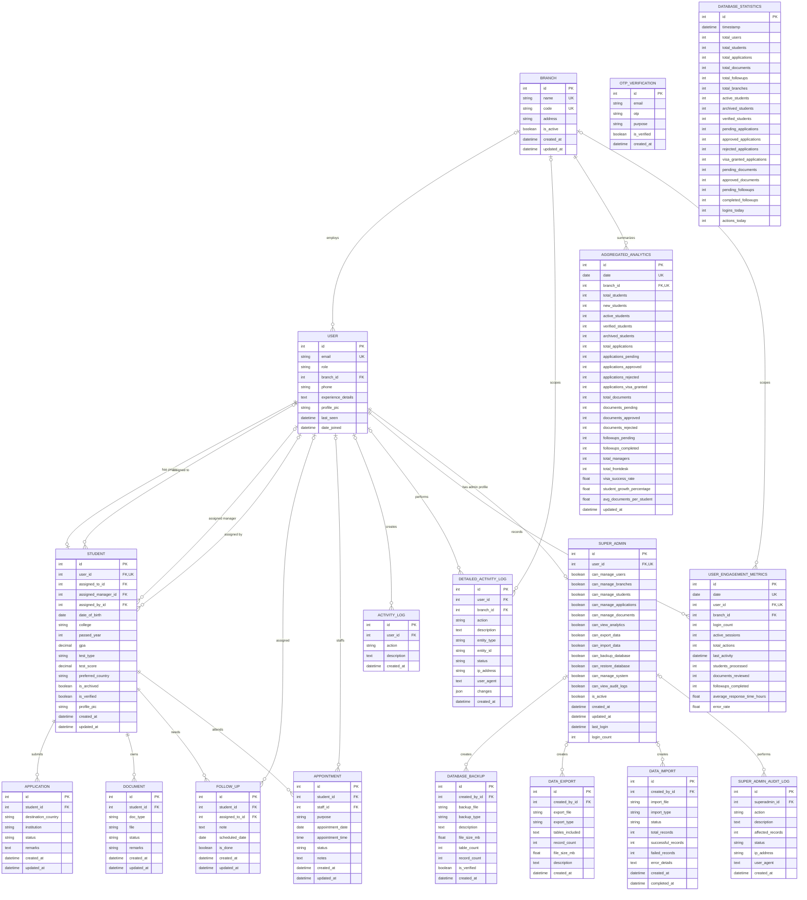

# DristiSewa Entity-Relationship Diagram

This diagram represents the implemented application data model and its 18
application tables. Django's 7 infrastructure tables are intentionally omitted:
`django_admin_log`, `django_content_type`, `django_migrations`, `django_session`,
`auth_group`, `auth_group_permissions`, and `auth_permission`. Every entity has
an implicit Django `id` primary key unless a key is explicitly named. Models that
inherit `TimeStampedModel` also contain `created_at` and `updated_at`.

## Notes

- `USER.role` distinguishes Admin, Manager, Front Desk, and Student accounts.
- The unused `User.groups` and `User.user_permissions` relationships were removed;
    the corresponding `accounts_user_groups` and `accounts_user_user_permissions`
    tables are not part of the database.
- `STUDENT.user_id` and `SUPER_ADMIN.user_id` are one-to-one relationships.
- `AGGREGATED_ANALYTICS` is unique per `(date, branch)` and
  `USER_ENGAGEMENT_METRICS` is unique per `(date, user)`.
- `OTP_VERIFICATION` and `DATABASE_STATISTICS` are standalone operational
  records. OTP records deliberately use email rather than a user foreign key
  because they can be created before registration.
- The database currently contains 25 tables in total: 18 application tables and
    7 Django infrastructure tables.
